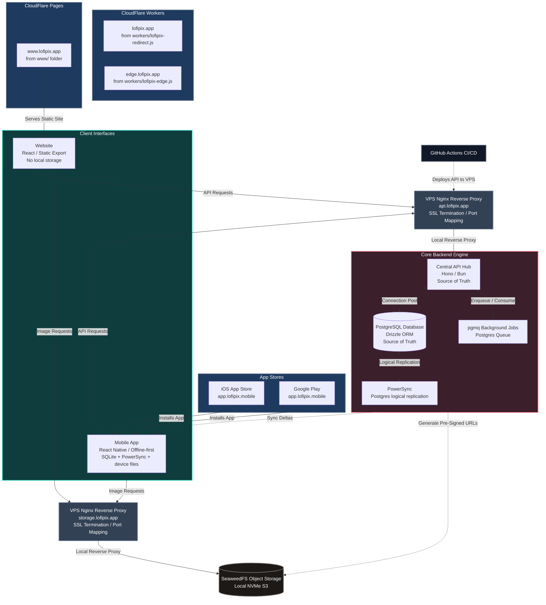

# lofipix

## About

LoFi Pix is a system initially targeted at panel-beaters (auto body repair shops) to capture and upload vehicle damage photos on their mobile device.
They are stored as albums.
Photos are reduced in size and quality to minimize data usage.
These are uploaded to cloud storage.
These are then synced to clients own storage, such as a OneDrive folder, or a Google Drive folder.
These can then be attached to emails, where 10-20 photos will fit under 10MB.

There is a public website detailing what LoFi Pix is, and administer organisations, users, albums and photos.
The primary way of capturing photos is an offline-first, local-first native app for iOS and Android.

## General mobile app behaviour

- create an album. usually with a vehicle plate number
- option to add in "notes", which will be added to the album as notes.txt
- take 6-20 photos per vehicle
- compress photos locally, to under 300kb (saves mobile data)
- uploads photos to cloud storage
- photos from cloud storage optionally sync to Microsoft OneDrive or Google Drive

## Photo Compression

Photos compressed to under 300KB each using:
- Resize to max 1280px width
- JPEG quality reduction
- Second pass (reducing quality) if still over target size

## Architecture

## Directory structure

| Path | Description | Technology |
| --- | --- | --- |
| `api/` | Central API, source of truth | Hono + Bun + Drizzle ORM + PostgreSQL + PowerSync token/upload endpoints + pgmq |
| `packages/db/` | Database schema (Drizzle `push`), shared Zod models and Better Auth config | TypeScript + Drizzle ORM + PostgreSQL + Better Auth (auth schema, cookie + bearer sessions) |
| `packages/ui/` | Shared web components (ShadCN on Radix + Tailwind CSS v4), Iconify icons (unplugin-icons), Storybook component isolation, Vitest story tests | React + Radix + Tailwind CSS v4 + unplugin-icons + Storybook + Vitest, Bun |
| `docs/` | Architecture and operations documentation | Markdown (see `ARCHITECTURE.md`, `AUTHENTICATION.md`, `POWERSYNC.md`, `MOBILE.md`, `PHOTOS.md`, `PHOTO_LOCATIONS.md`, `SHADCN.md`, `ICONS.md`, `UPTRACE.md`) |
| `mobile/` | Native iOS/Android app, offline-first, device-only photo bytes | React Native (bare CLI) + React Navigation + SQLite (op-sqlite) + PowerSync + TanStack DB + TanStack Form + Jest + Maestro, Node.js via ASDF + npm |
| `powersync/` | Self-hosted PowerSync service config, sync streams, Dockerfile and systemd unit | PowerSync Service (Docker, host network) + PostgreSQL + systemd |
| `scripts/` | Operational scripts (incl. database reset and demo seeding) | TypeScript + Bun (workspace package) |
| `workers/` | CloudFlare Workers | JavaScript |
| `www/` | Website (plain static site, no sync) | React + TanStack Router (React) + TanStack Query + TanStack Form + ShadCN (`@lofipix/ui`) + Vite, static export, Bun |

## General technologies

- **Website**: React + TanStack Router (React) + TanStack Query (data fetching + caching with automatic retry) + TanStack Form + Zod, ShadCN + Tailwind CSS v4 from `@lofipix/ui`, static export
- **Mobile**: bare React Native + React Navigation native-stack, embedded SQLite (`@op-engineering/op-sqlite` via PowerSync), PowerSync sync streams, TanStack DB collections, React state/context + StyleSheet design tokens
- **Mobile auth**: Better Auth bearer tokens stored in `react-native-keychain`; website keeps Better Auth cookie sessions
- **Mobile client storage**: SQLite for relational data, app documents directory for photo bytes
- **Sync**: self-hosted PowerSync with JWT scoping, version-checked uploads and client auto-rebase; PowerSync owns the mobile SQLite cache
- **Backend**: Bun, Hono (central API, source of truth), Drizzle ORM, PostgreSQL (source of truth), PowerSync, pgmq for background jobs
- **Authorization**: via the Better Auth organisation plugin (see `docs/AUTHENTICATION.md`)
- **Package manager**: Bun for repository workspaces (`bun.lock`); `mobile/` uses npm (`mobile/package-lock.json`) with Node.js pinned by ASDF in `mobile/.tool-versions`
- **Shared**: TypeScript (strict, no `any` in domain models), Zod (every API response and database record has a schema), Shared Models, typed API modules (no direct `fetch()` calls in components)
- **Async state**: Every async operation has explicit loading, error, success, and offline states
- **Database**: PostgreSQL — Better Auth tables in the `auth` schema, application tables in `public` via `drizzle-kit push`; tombstones / soft-delete rows on synced tables
- **Storage**: SeaweedFS (S3-compatible); clients use pre-signed URLs generated by the API, never S3 credentials directly
- **Testing**: Vitest + Playwright (web/UI); Jest + React Native Testing Library + Maestro (mobile)
- **Observability**: Uptrace (self-hosted; see `docs/UPTRACE.md`)
- **Deployment**: VPS, GitHub Actions; website on Cloudflare Workers; mobile stores documented in `docs/DEPLOYMENT.md`
