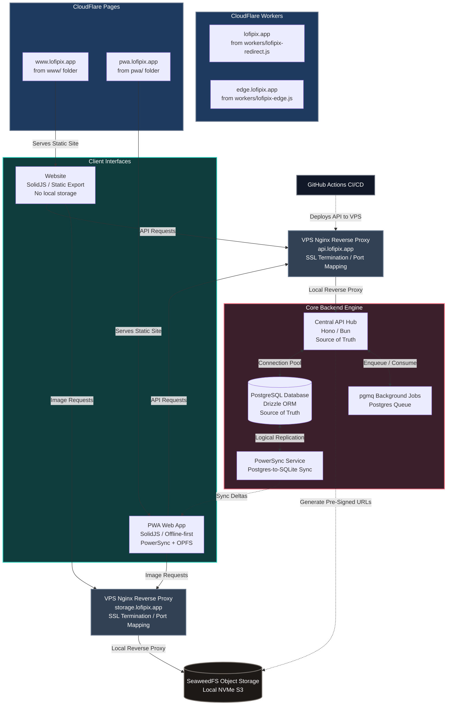

# lofipix

## About

LoFi Pix is a system initially targeted at panel-beaters (auto body repair shops) to capture and upload vehicle damage photos on their mobile device.
They are stored as albums.
Photos are reduced in size and quality to minimize data usage.
These are uploaded to cloud storage.
These are then synced to clients own storage, such as a OneDrive folder, or a Google Drive folder.
These can then be attached to emails, where 10-20 photos will fit under 10MB.

There is a public website detailing what LoFi Pix is, and administer organisations, users, albums and photos.
The primary way of capturing photos is by an offline-first, local-first PWA

## General PWA behaviour

- create an album. usually with a vehicle plate number
- option to add in "notes", which will be added to the album as notes.txt
- take 6-20 photos per vehicle
- compress photos locally, to under 300kb (saves mobile data)
- uploads photos to cloud storage
- photos from cloud storage optionally sync to Microsoft OneDrive or Google Drive

## Photo Compression

Photos compressed to under 300KB each using:
- Resize to max 1280px width
- JPEG quality reduction
- Second pass (reducing quality) if still over target size

## Architecture

## Directory structure

| Path | Description | Technology |
| --- | --- | --- |
| `api/` | Central API, source of truth | Hono + Bun + Drizzle ORM + PostgreSQL + PowerSync Service + pgmq |
| `packages/db/` | Database schema (Drizzle `push`) + Better Auth config | TypeScript + Drizzle ORM + PostgreSQL + Better Auth (auth schema) |
| `packages/ui/` | Shared TarkUI components (Ark UI + Tailwind CSS v4), Iconify icons (unplugin-icons), Storybook component isolation, Vitest story tests | SolidJS + Ark UI + Tailwind CSS v4 + unplugin-icons + Storybook + Vitest, Bun |
| `docs/` | Architecture and operations documentation | Markdown (see `ARCHITECTURE.md`, `AUTHENTICATION.md`, `TARKUI.md`, `ICONS.md`, `UPTRACE.md`) |
| `pwa/` | Progressive Web Application, offline-first | SolidJS + TanStack Router (Solid) + Vite + VitePWA + PowerSync Web SDK (OPFS-backed SQLite) + TanStack DB + TanStack Query, Bun |
| `scripts/` | Operational scripts (incl. database reset) | TypeScript + Bun (workspace package) |
| `workers/` | CloudFlare Workers | JavaScript |
| `www/` | Website (plain static site, no PWA, no PowerSync) | SolidJS + TanStack Router (Solid) + Vite, static export, Bun + Ark UI + Tailwind CSS + TanStack Query |

## General technologies

- **Frontend**: SolidJS (declarative components), Tailwind CSS + Ark UI (`@ark-ui/solid`, "Tark UI"), TanStack Router (Solid), TanStack Query (data fetching + caching with automatic retry), TanStack DB (reactive UI collections over the PWA's local store), TanStack Form + Zod, Solid signals/stores for client state, Solid-native transitions + CSS for animation
- **Website**: SolidJS + TanStack Router, static export, TanStack Query, no PowerSync and no local persistence
- **PWA client storage**: OPFS for local binary/image files, OPFS-backed SQLite via PowerSync Web SDK
- **Sync**: PowerSync for offline-first data synchronization (PowerSync Service: PostgreSQL-to-SQLite; PowerSync Web SDK on client)
- **Backend**: Bun, Hono (central API, source of truth), Drizzle ORM, PostgreSQL (source of truth), PowerSync Service, pgmq for background jobs
- **Authorization**: via the Better Auth organisation plugin (see `docs/AUTHENTICATION.md`)
- **Package manager**: Bun (`bun install`, `bun.lock`)
- **Shared**: TypeScript (strict, no `any` in domain models), Zod (every API response and database record has a schema), Shared Models, typed API modules (no direct `fetch()` calls in components)
- **Async state**: Every async operation has explicit loading, error, success, and offline states
- **Database**: PostgreSQL — Better Auth tables in the `auth` schema, application tables in `public` via `drizzle-kit push`; tombstones / soft-delete rows on synced tables
- **Storage**: SeaweedFS (S3-compatible); clients use pre-signed URLs generated by the API, never S3 credentials directly
- **Testing**: Vitest + Playwright
- **Observability**: Uptrace (self-hosted; see `docs/UPTRACE.md`)
- **Deployment**: VPS, GitHub Actions
