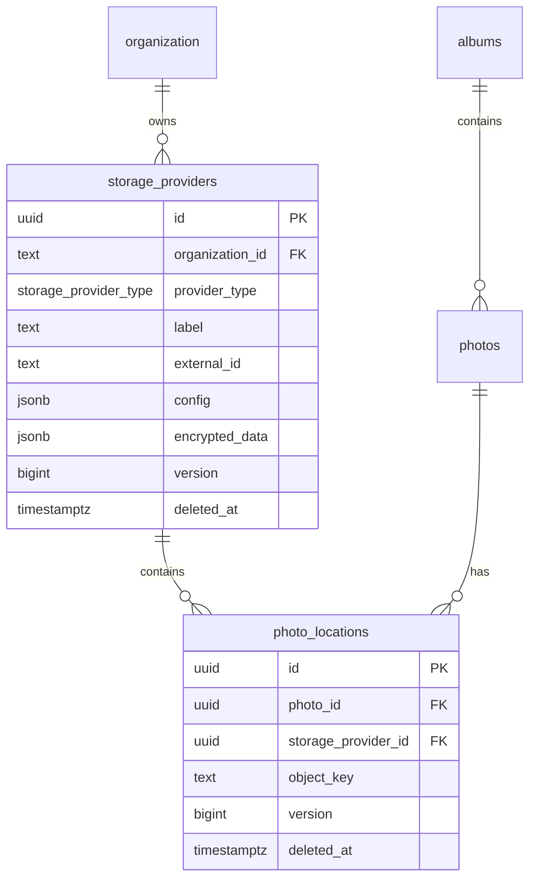

# Photo locations

This document describes how photo bytes are located across the backing stores
used by lofipix. The `photos` row holds image metadata and never the bytes
themselves (see `docs/PHOTOS.md`). A photo can exist in several places at once:

- **Device filesystem (`opfs`/`app_fs` provider type)** — the local copy on the mobile device that captured it;
- **S3** — the canonical copy in LoFi Pix object storage;
- **OneDrive / Google Drive** — an optional copy exported to the customer's
  own drive.

`storage_providers` describes where a copy can be stored. `photo_locations`
records that a photo has actually been written to one of those providers. A
location row is evidence that the bytes exist; it is created only after the
write has been verified.

There is deliberately **no `devices` table**. Each mobile device is an ordinary
`opfs` or `app_fs` storage provider, identified by a client-minted device UUID.

## Data model



`organization` is `auth.organization`, owned by Better Auth (see
`docs/AUTHENTICATION.md`). `albums` and `photos` are the application tables
described in `docs/PHOTOS.md`.

Relationships:

- An organisation owns zero or more storage providers. Every provider belongs
  to exactly one organisation.
- A photo has zero or more locations, at most one live location per provider.
- A provider can hold locations for many photos.
- Locations have no `organization_id`; tenancy follows the parent photo and its
  album. The API checks that the photo and provider resolve to the caller's
  organisation before accepting a location.

## Models

Implemented in `packages/db/models/`:

| File | Contents |
| --- | --- |
| `packages/db/models/storage-provider.ts` | `pgEnum('storage_provider_type', …)`, Drizzle table `storage_providers`, `storageProviderSelectSchema`, `storageProviderInsertSchema`, types `StorageProvider` / `NewStorageProvider`. |
| `packages/db/models/photo-location.ts` | Drizzle table `photo_locations`, `photoLocationSelectSchema` / `photoLocationInsertSchema`, types `PhotoLocation` / `NewPhotoLocation`. |

Both tables are re-exported from `packages/db/schema.ts` so
`drizzle-kit push` owns them. No auth tables are added to the Drizzle schema;
the organisation FK uses the existing `authOrganization` proxy from
`packages/db/external/auth-tables.ts`.

Ids are UUIDv7 generated with `uuidv7()` from the `uuid` package, never
`Bun.randomUUIDv7()`. The mobile app must be able to mint provider and location
ids offline.

## `storage_providers`

| Column | Type | Notes |
| --- | --- | --- |
| `id` | `uuid` | UUIDv7, primary key. The mobile app mints this for an `opfs` or `app_fs` provider created offline. |
| `organization_id` | `text` | Foreign key to `auth.organization(id)`, `ON DELETE CASCADE`. Not null. A provider always belongs to exactly one organisation. |
| `provider_type` | `storage_provider_type` | Not null. Enum: `opfs`, `app_fs`, `s3`, `onedrive`, `google_drive`. |
| `label` | `text` | Human-readable name shown in the UI, e.g. "LoFi Pix cloud", "Paul's OneDrive", "Pixel 8". Not null. |
| `external_id` | `text` | Not null. Provider-native identity. See [Provider identity](#provider-identity). |
| `config` | `jsonb` | Not null, default `{}`. Public, non-secret provider settings. Synced to the mobile app as part of the `storage_providers` sync stream. |
| `encrypted_data` | `jsonb` | Not null, default `{}`. Encrypted-at-rest JSONB column holding individually encrypted secret fields. Synced to the mobile app and returned from client-facing endpoints; only the API server holds `STORAGE_PROVIDER_CREDENTIALS_KEY` and can decrypt it. |
| `version` | `bigint` | Server-incremented optimistic-concurrency version. Starts at 1. |
| `deleted_at` | `timestamptz` | Tombstone. Null for live rows. |
| `created_at` | `timestamptz` | Row creation time, `now()` by default. |
| `updated_at` | `timestamptz` | Row update time, `now()` by default. |

### Provider identity

`external_id` is required for every type and is unique per organisation and
provider type:

| Type | `external_id` |
| --- | --- |
| `opfs` | Client-minted UUIDv7 device identifier. This is the mobile device's stable identity; `storage_providers.id` is a separate row id. |
| `app_fs` | Client-minted UUIDv7 device identifier. Same as `opfs` for native apps; `storage_providers.id` is a separate row id. |
| `s3` | Bucket name, e.g. `storage-cholet-lofipix`. |
| `onedrive` | OneDrive drive id (personal or business). |
| `google_drive` | Google Drive shared-drive or user drive id. |

The unique constraint is partial so a provider can be tombstoned and
re-registered:

```sql
UNIQUE (organization_id, provider_type, external_id)
WHERE deleted_at IS NULL
```

The same device UUID may appear in more than one organisation, each with its
own `opfs` or `app_fs` provider row. The same bucket can back several organisations; the
constraint is per organisation.

### Provider config

`config` holds public provider settings and operational metadata. Secrets
live in the same row's `encrypted_data` JSONB column, keyed by secret field
name. The Zod schemas validate `config` per provider type.

**Device filesystem (`opfs` / `app_fs`)**

```json
{
  "platform": "ios",
  "deviceName": "Paul's iPhone",
  "model": "iPhone 15",
  "osVersion": "18.5",
  "appVersion": "1.4.0",
  "userAgent": "Mozilla/5.0 …"
}
```

- `platform` is required and is `ios` or `android`.
- `deviceName`, `model`, `osVersion`, `appVersion` and `userAgent` are
  optional. They exist to label the device and diagnose capture problems.
- An `opfs` or `app_fs` provider has no secrets; `encrypted_data` stays `{}`.
- These values are personal data and are visible to the other devices in the
  organisation through the `storage_providers` sync stream.

**S3**

```json
{
  "endpoint": "https://oceania.lofipix.app",
  "region": "oceania",
  "prefix": "",
  "addressingStyle": "path"
}
```

`endpoint`, `prefix` and `addressingStyle` come from the region
configuration. The bucket is `external_id`, not part of `config`.
`addressingStyle` selects how the bucket is addressed against the endpoint:
`"path"` puts the bucket in the URL path (`{endpoint}/{bucket}/{key}`) and
`"virtual"` puts it in the host name (`https://{bucket}.{host}/{key}`), so
the same provider works with S3-compatible services that use either
bucket-in-DNS or path-style addressing.

There are no secrets on the row: SeaweedFS access keys come from the region
environment (`SEAWEEDFS_ACCESS_KEY` / `SEAWEEDFS_SECRET_KEY`).
`encrypted_data` stays `{}`.

**OneDrive / Google Drive**

```json
{
  "rootFolder": "LoFi Pix",
  "accountEmail": "office@panel-beater.example",
  "expiresAt": "2026-12-01T10:00:00.000Z",
  "scope": "offline_access Files.ReadWrite",
  "tokenType": "Bearer"
}
```

The secret fields live in `encrypted_data`:

```json
{
  "accessToken": "<iv>:<tag>:<ciphertext>",
  "refreshToken": "<iv>:<tag>:<ciphertext>",
  "tenantId": "<iv>:<tag>:<ciphertext>"
}
```

Google Drive additionally stores `rootFolderId` once the folder is created.
`rootFolder` is the folder LoFi Pix owns inside the customer's drive;
`object_key` is always relative to it. `accountEmail` is display information
only and is not used as the provider identity.

`expiresAt`, `scope` and `tokenType` are plaintext operational metadata in
`config`. The `encrypted_data` column holds only secret fields:

| Field | Treatment |
| --- | --- |
| `encrypted_data.accessToken` | Individually encrypted. Required for a connected cloud provider. |
| `encrypted_data.refreshToken` | Individually encrypted. Required when the provider issues one. |
| `encrypted_data.tenantId` | Individually encrypted when present (OneDrive business). |
| `encrypted_data.accountId` | Individually encrypted when present. |

The same mechanism applies to any long-lived key/secret pair a future provider
needs. For example, if S3 keys were stored per provider rather than in the
region environment, an `aws_secret_access_key` field would live under
`encrypted_data` with the same `<iv>:<tag>:<ciphertext>` value.

**Encryption**

Each value in the `encrypted_data` column is encrypted separately with
AES-256-GCM:

- a fresh random 96-bit (12-byte) IV per field per encryption;
- a 128-bit (16-byte) authentication tag;
- the value is `base64(iv):base64(tag):base64(ciphertext)`;
- the 32-byte key comes from `STORAGE_PROVIDER_CREDENTIALS_KEY` in
  `.env.<REGION>`, hex-encoded, and is never committed.

Encryption and decryption split the value on `:` into exactly three parts,
base64-decode each part, and create the cipher with the IV and tag. A value
that does not contain exactly three non-empty parts is invalid.

There is no key-version prefix. To rotate the key, every `encrypted_data`
field in every row must be decrypted with the old key and re-encrypted with
the new one. This is a deliberate simplification; a future version can add a
prefix without changing the column type.

The encryption helpers live in `packages/db/crypto.ts`:
`encryptCredential` and `decryptCredential`. Secrets are decrypted only inside
the API and background jobs. They are never logged; the encrypted blob is
synced to the mobile app and returned from client-facing endpoints, but the
plaintext is never exposed.

**Public config**

`storageProviderSelectSchema` and `storageProviderInsertSchema` cover the full
row including `encrypted_data`. Non-secret fields (`platform`, `endpoint`,
`rootFolder`, `expiresAt`, `scope`, `tokenType`, …) remain visible alongside
the encrypted blob, and the `storage_providers` PowerSync stream selects
`storage_providers.*` (see [PowerSync](#powersync)).

There is no "masked token" field: clients learn whether a provider is
connected from its tombstone state and OAuth status, not from encrypted
contents.

### Provider constraints and indexes

- `CHECK (length(btrim(label)) > 0)`.
- `CHECK (length(btrim(external_id)) > 0)`.
- `CHECK (jsonb_typeof(config) = 'object')`.
- `CHECK (jsonb_typeof(encrypted_data) = 'object')`.
- `CHECK ((provider_type <> 'opfs' AND provider_type <> 'app_fs') OR (config ? 'platform' AND config ->> 'platform' IN ('ios', 'android')))`.
- Partial unique index on `(organization_id, provider_type, external_id)`
  where `deleted_at IS NULL`.
- Index on `organization_id` for listing an organisation's providers.

Application rules, not SQL constraints:

- An `opfs` or `app_fs` provider has `encrypted_data = {}`.
- An S3 provider has `encrypted_data = {}`; its access keys come from the
  region environment (`SEAWEEDFS_ACCESS_KEY` / `SEAWEEDFS_SECRET_KEY`).
- A connected OneDrive/Google Drive provider has an `encrypted_data` object
  containing at least `accessToken`; every value matches
  `base64(iv):base64(tag):base64(ciphertext)`. A row without this is treated
  as not connected. Disconnecting tombstones the row and sets
  `encrypted_data = {}`.
- A photo and a provider may only be linked when both belong to the same
  organisation.

### Multiple providers

An organisation may define several providers of the same type. The UI selects
the destination; there is no database-level default. S3 is canonical by
type, OneDrive/Google Drive copies are replicas, and `opfs`/`app_fs` are local copies.

Every organisation has at least one S3 provider. The API provisions it
idempotently, either when the organisation is created or on first use, using
the region's bucket and endpoint.

## `photo_locations`

| Column | Type | Notes |
| --- | --- | --- |
| `id` | `uuid` | UUIDv7, primary key. |
| `photo_id` | `uuid` | Foreign key to `photos(id)`, `ON DELETE CASCADE`. Not null; tenancy follows the photo's album. |
| `storage_provider_id` | `uuid` | Foreign key to `storage_providers(id)`, `ON DELETE CASCADE`. Not null. |
| `object_key` | `text` | Not null. Provider-native path/key of the bytes. |
| `version` | `bigint` | Server-incremented optimistic-concurrency version. Starts at 1. |
| `deleted_at` | `timestamptz` | Tombstone. Null for live rows. |
| `created_at` | `timestamptz` | Row creation time, `now()` by default. |
| `updated_at` | `timestamptz` | Row update time, `now()` by default. |

The row has no checksum or size column: `photos.image_checksum` and
`photos.image_size` describe the single set of bytes that every location
holds. A location is only written after those bytes were verified.

### Location constraints and indexes

- `UNIQUE (photo_id, storage_provider_id) WHERE deleted_at IS NULL` — one live
  copy per photo per provider. Re-uploading after a tombstone creates a new
  row.
- `CHECK (length(btrim(object_key)) > 0)`.
- Indexes on `storage_provider_id` and `photo_id`.

A photo can therefore have several live locations at once: its device-local copy, the
S3 copy and any number of cloud-drive copies.

## Object key layout

Keys are deterministic and per photo. The key is stored in `object_key` and is
never recomputed at read time, so a provider-specific variation can be
introduced without changing the schema.

| Provider | `object_key` |
| --- | --- |
| S3 | `{organizationId}/albums/{albumId}/photos/{photoId}.jpg`, optionally prefixed by the provider's `config.prefix`. |
| OneDrive | `{albumName}/{photoPosition}.jpg`, relative to `config.rootFolder`. |
| Google Drive | `{albumName}/{photoPosition}.jpg`, Same path relative to the configured root folder. |
| `opfs` | `photos/{photoId}.jpg` inside the mobile app's documents directory. The device is identified by the provider's `external_id`. |
| `app_fs` | `photos/{photoId}.jpg` inside the native app's documents/sandbox directory. The device is identified by the provider's `external_id`. |

Rules:

- Keys for S3, `opfs`, and `app_fs` contain only UUIDs and fixed path segments; no user-supplied album
  names, plate numbers or file names.
- Bytes are the compressed JPEG described by `photos.image_*`; there are no
  separate thumbnail or original objects in this model.
- Keys are not content-addressed. Two photos with identical checksums keep
  separate objects; de-duplication is an application-level upload decision,
  not shared storage. This keeps deletion unambiguous.
- The API validates that a client-confirmed S3 key equals the expected
  deterministic key before inserting a location.

## Lifecycle

### Organisation provisioning

The API ensures each organisation has a S3 provider. Provisioning is
idempotent through the `(organization_id, provider_type, external_id)` unique
index. The provider's `external_id` is the region bucket, `config` holds the
endpoint and prefix, and there is no `encrypted_data`.

### `opfs` / `app_fs` provider provisioning

On first run for an organisation, the mobile app:

1. loads or creates a device UUID (UUIDv7), persisted in app storage;
2. mints a provider row id (UUIDv7);
3. inserts the `opfs` or `app_fs` `storage_providers` row with `label` and `config`;
4. inserts its local locations as photos are captured;
5. syncs the rows through PowerSync's upload queue when connectivity returns.

The provider is created offline; no API call is required. If app storage is
cleared, a new device UUID and provider are created. The old provider remains
until an administrator tombstones it manually; there is no `last_seen_at`
column or automatic device expiry.

The same device UUID may be registered in another organisation; that creates a
separate provider row in that organisation.

### Capture and local write

1. The camera capture is compressed to a JPEG (see `docs/PHOTOS.md`).
2. The mobile app computes the image size and lowercase hex SHA-256.
3. It writes the bytes to the documents directory at `photos/{photoId}.jpg`.
4. It verifies the stored bytes (read back and hash, or hash while writing).
5. It inserts the `photos` row and the local device (`opfs`/`app_fs`) `photo_locations` row into local
   SQLite; TanStack DB/PowerSync queue the metadata upload.
6. PowerSync posts the photo, provider and location rows to
   `POST /api/sync/upload`; metadata sync remains queued while offline.

A photo without `image_checksum` cannot have a location row; hashing is part of
the write.

### S3 upload and verification

The mobile app obtains a short-lived pre-signed PUT URL from the API, uploads
the bytes, then confirms the upload. The API reads the uploaded object back and
hashes it; it does not trust a client-supplied checksum or S3 metadata alone.
`photos.image_checksum` and `photos.image_size` are the comparison values. A
mismatch rejects the location, and the invalid object is left for the orphan
cleanup job.

Proposed endpoints (implemented in a later task):

| Method | Path | Purpose |
| --- | --- | --- |
| `POST` | `/photos/:id/upload-url` | Returns a short-lived pre-signed PUT URL, required headers, the deterministic `objectKey` and an expiry. |
| `POST` | `/photos/:id/locations` | Confirms and verifies a S3 upload; inserts the location. Idempotent. |

### OneDrive / Google Drive export

Cloud export is server-side, driven by pgmq:

1. The API enqueues one job per photo and target provider, or a batched album
   job.
2. The worker decrypts the individual secret fields in
   `encrypted_data`, refreshes the OAuth token if needed and
   re-encrypts the changed fields.
3. It ensures the root folder exists, creates the album/photo folders, and
   uploads the S3 object (streamed; never buffered in the database).
4. It verifies the remote size and checksum or provider ETag.
5. It inserts the `photo_locations` row. A live location already present means
   the job is done.
6. Transient failures retry with backoff. A revoked token or missing scope
   fails the job and surfaces a reconnect state; no location row is written.

Clients never call the provider APIs and never receive the tokens.

Export jobs and API routes are implemented in a separate task.

### Read path

For a photo, the client resolves the best available copy:

1. **Device filesystem** — read `photos/{photoId}.jpg` from the app documents
   directory, no network. This is the normal path on the capturing device.
2. **S3** — `GET /photos/:id/content` (or a download-URL endpoint)
   validates organisation membership and a live S3 location, then
   returns a short-lived pre-signed GET URL or redirects to it.
3. **OneDrive / Google Drive** — the API reads the object with the secret
   fields in `encrypted_data` and proxies the bytes, or returns a
   short-lived provider link. Proxying is preferred because provider links can
   leak beyond the organisation. Tokens never reach the client.

The client must ignore locations whose provider is tombstoned, and must fall
back if a location is stale. "Synced" in the UI means at least one live cloud
location exists, not merely that a local row was written.

Content endpoints (`GET /photos/:id/content`) and provider API routes are
implemented in a later task.

### Delete and retention

- Deleting a photo tombstones `photos.deleted_at`, its local device (`opfs`/`app_fs`) locations and its
  S3 locations.
- Deleting an album tombstones the album and all its photos, and follows the
  same location rules.
- Device filesystem bytes are deleted locally by the mobile app.
- A pgmq cleanup job deletes the S3 object 30 days after the location
  tombstone (configurable). The grace period lets other devices receive the
  deletion first.
- **OneDrive / Google Drive copies are never deleted by LoFi Pix.** They are
  the customer's exported archive. Their location rows stay live after the
  photo is tombstoned; only the photo is hidden.
- The cleanup job deletes only objects that no live `photo_locations` row
  references.

### Provider disconnect

- **OneDrive / Google Drive**: tombstone the provider, stop new export jobs,
  set `encrypted_data = {}`, and keep
  the files and location rows. Reconnecting revives the same provider row
  with new secrets rather than creating a duplicate.
- **Device filesystem (`opfs` / `app_fs`)**: tombstone the provider, stop uploads, and
  clean local bytes. The location rows remain as tombstones.
- **S3**: canonical, so it cannot be disconnected while the
  organisation has live photos.

### Orphan cleanup

The cleanup job also handles objects with no location row:

- an object written by a pre-signed PUT but never confirmed;
- an object whose checksum/size verification failed;
- a location tombstoned longer than the retention period.

It should use a provider-specific listing or a recorded upload intent. The
upload queue is the primary record; the database does not store pending
locations by design.

The cleanup job is implemented in a later task.

## PowerSync

Sync Streams are defined in `powersync/sync-config.yaml` and served at
`https://<region>.lofipix.app/powersync/`. `POST /api/sync/token` mints a JWT
whose `organization_id` claim scopes every stream.

- `albums` and `storage_providers` filter directly on `organization_id`;
- `photos` and `photo_locations` join through `albums`;
- `storage_providers` is synced in full, including the encrypted-at-rest
  `encrypted_data` column;
- tombstones are synced and the mobile app filters `deleted_at is null`.

`opfs` and `app_fs` providers and locations can be created in the mobile app's
local SQLite database and sent through PowerSync's upload queue. The API-side
upload validation enforces:

- the provider's organisation matches the signed-in user's membership;
- `opfs`/`app_fs` providers have a UUID `external_id`, a valid `platform` and
  `encrypted_data = {}`;
- a location's photo resolves to the same organisation through its album, and
  the provider belongs to that organisation;
- the local device (`opfs`/`app_fs`) `object_key` matches `photos/{photoId}.jpg`;
- the location is unique among live rows.

S3 locations are written by the API after verification, not by the upload
queue. OneDrive/Google Drive locations are written only by the export worker.
The upload payload for a provider may include public `config`; it can never
include `encrypted_data`.

## Security

- **Authorisation**: every read/write checks Better Auth organisation
  membership. A provider, photo and location are always reconciled to the same
  organisation; cross-organisation ids are rejected.
- **Credentials**: each secret field in the `encrypted_data` column is
  individually encrypted with AES-256-GCM. The encrypted blob is synced to the
  mobile app and returned from client-facing endpoints; it is never logged and
  is only decrypted in the API process or a trusted worker.
- **Object access**: S3 is private. Clients receive short-lived
  pre-signed URLs scoped to one object; they never hold S3 credentials.
- **Key validation**: `object_key` is validated against the deterministic
  expected value before any location insert or provider API call. Reject path
  traversal, absolute paths and keys belonging to another photo.
- **PII**: `opfs`/`app_fs` `config` contains device details and is visible to the other
  devices in the same organisation through the org-scoped sync stream. Do not add
  advertising identifiers or precise location.
- **Provider metadata**: `config.accountEmail` and labels are non-secret but
  visible to other devices in the same organisation.

## Failure handling

| Situation | Behaviour |
| --- | --- |
| Mobile offline during capture | Photo, local device provider (`opfs`/`app_fs`) and location stay local; metadata sync queued. |
| App storage cleared | New device UUID and `opfs`/`app_fs` provider; old provider remains until manually tombstoned. |
| Pre-signed PUT succeeds, confirmation never arrives | No location row; orphan cleanup removes the object after the retention window. |
| Uploaded bytes fail size/checksum | Location rejected; object removed/quarantined; client may retry. |
| Duplicate confirmation | Idempotent; return the existing live location. |
| Photo/provider organisation mismatch | Rejected with 403/422; no row written. |
| Provider tombstoned during upload | Confirmation rejected; object cleaned up. |
| OAuth token expired during export | Refresh and re-encrypt the changed `encrypted_data` fields; retry. If refresh fails, job fails and the provider shows reconnect required. |
| Drive file already exists | Treat as idempotent success after verifying size/checksum; do not create a duplicate location. |
| Photo deleted before upload | Cancel the queued upload and delete local device bytes; no S3/cloud copy is created. |
| Location tombstoned then re-uploaded | New location row; the partial unique index allows it. |
| Stale local device provider (`opfs`/`app_fs`) | Manual tombstone from the website; its locations are tombstoned and local bytes are already gone. |

## API surface

These endpoints are proposals for a later implementation; no routes exist yet.
All are API-only, authenticated, and scoped to the caller's organisation.

| Method | Path | Purpose |
| --- | --- | --- |
| `GET` | `/storage-providers` | List providers. The full row, including the encrypted-at-rest `encrypted_data`, is returned. |
| `POST` | `/storage-providers` | Create a non-`opfs`/non-`app_fs` provider. `opfs`/`app_fs` providers are created by the mobile app and arrive through the upload queue. |
| `PATCH` | `/storage-providers/:id` | Update `label` and non-secret `config` fields; `encrypted_data` is preserved when present. |
| `DELETE` | `/storage-providers/:id` | Tombstone/disconnect a provider. |
| `POST` | `/storage-providers/:id/reconnect` | Start the OAuth flow for a tombstoned cloud provider. |
| `GET` | `/storage-providers/oauth/:type/callback` | OAuth callback; stores `encrypted_data`. |
| `POST` | `/photos/:id/upload-url` | Issue a pre-signed PUT for S3. |
| `POST` | `/photos/:id/locations` | Confirm and verify a S3 upload. |
| `GET` | `/photos/:id/content` | Read local/remote content or redirect to a pre-signed URL. |
| `POST` | `/albums/:id/export` | Enqueue cloud export for the album's photos. |

## Implementation status

Completed in this task:

- `packages/db/models/storage-provider.ts` — `storage_providers` table, enum, `storageProviderSelectSchema` / `storageProviderInsertSchema` Zod schemas, `encrypted_data` column, types.
- `packages/db/models/photo-location.ts` — `photo_locations` table with version and parent FKs, Zod schemas, types.
- `packages/db/crypto.ts` — per-field AES-256-GCM encryption/decryption.
- `packages/db/schema.ts` — re-exports both new models.
- `scripts/reset-database.ts` — verification asserts both tables, composite foreign keys, partial unique indexes and check constraints.
- `docs/POWERSYNC.md` — installing and running PowerSync under systemd; `powersync/sync-config.yaml` defines the provider/location projections.
- Mobile PowerSync tables and the upload queue support provider/location rows.
- `.env.example` — adds `STORAGE_PROVIDER_CREDENTIALS_KEY` and the PowerSync service variables.

Deferred to later tasks:

- API routes (`/storage-providers/*`, `/photos/:id/*`, `/albums/:id/export`).
- pgmq export, verification and cleanup jobs.
- Photo byte upload and S3/cloud location creation.
- www/ client implementation.
