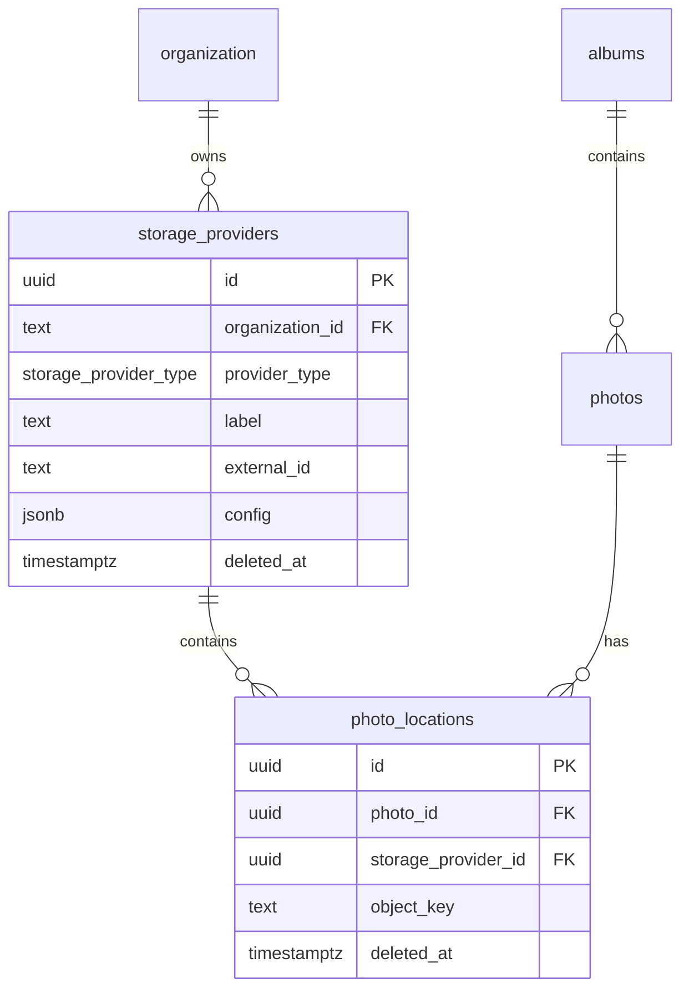

# Photo locations

This document specifies how photo bytes are located across the backing stores
used by lofipix. It is a **design document only**: the models and API endpoints
described here are proposed and have not been implemented yet.

The `photos` row holds image metadata and never the bytes themselves (see
`docs/PHOTOS.md`). A photo can exist in several places at once:

- **OPFS** — the local copy on the PWA device that captured it;
- **S3** — the canonical copy in LoFi Pix object storage;
- **OneDrive / Google Drive** — an optional copy exported to the customer's
  own drive.

`storage_providers` describes where a copy can be stored. `photo_locations`
records that a photo has actually been written to one of those providers. A
location row is evidence that the bytes exist; it is created only after the
write has been verified.

There is deliberately **no `devices` table**. Each PWA is an ordinary OPFS
storage provider, identified by a client-minted device UUID.

## Data model



`organization` is `auth.organization`, owned by Better Auth (see
`docs/AUTHENTICATION.md`). `albums` and `photos` are the application tables
described in `docs/PHOTOS.md`.

Relationships:

- An organisation owns zero or more storage providers. Every provider belongs
  to exactly one organisation.
- A photo has zero or more locations, at most one live location per provider.
- A provider can hold locations for many photos.
- Locations do not carry `organization_id`; the organisation is reached
  through the photo's album and through the provider. Application code must
  reject a location whose photo and provider belong to different
  organisations.

## Proposed models

Future files, following the conventions in `packages/db/models/`:

| File | Contents |
| --- | --- |
| `packages/db/models/storage-provider.ts` | `pgEnum('storage_provider_type', …)`, Drizzle table `storage_providers`, `storageProviderSelectSchema` (public, `config` without `encrypted_data`), `storageProviderServerSchema` (server-only, full `config`), `storageProviderInsertSchema` (server-only), types `StorageProvider` / `NewStorageProvider`. |
| `packages/db/models/photo-location.ts` | Drizzle table `photo_locations`, `photoLocationSelectSchema` / `photoLocationInsertSchema`, types `PhotoLocation` / `NewPhotoLocation`. |

Both tables are re-exported from `packages/db/schema.ts` so
`drizzle-kit push` owns them. No auth tables are added to the Drizzle schema;
the organisation FK uses the existing `authOrganization` proxy from
`packages/db/external/auth-tables.ts`.

Ids are UUIDv7 generated with `uuidv7()` from the `uuid` package, never
`Bun.randomUUIDv7()`. The PWA must be able to mint provider and location ids
offline in a browser.

## `storage_providers`

| Column | Type | Notes |
| --- | --- | --- |
| `id` | `uuid` | UUIDv7, primary key. The PWA mints this for an OPFS provider created offline. |
| `organization_id` | `text` | Foreign key to `auth.organization(id)`, `ON DELETE CASCADE`. Not null. A provider always belongs to exactly one organisation. |
| `provider_type` | `storage_provider_type` | Not null. Enum: `opfs`, `s3`, `onedrive`, `google_drive`. |
| `label` | `text` | Human-readable name shown in the UI, e.g. "LoFi Pix cloud", "Paul's OneDrive", "Pixel 8". Not null. |
| `external_id` | `text` | Not null. Provider-native identity. See [Provider identity](#provider-identity). |
| `config` | `jsonb` | Not null, default `{}`. Single JSONB object: non-secret provider settings plus, for providers with secrets, an `encrypted_data` object. Server-only fields are stripped from public reads. See [Provider config](#provider-config). |
| `deleted_at` | `timestamptz` | Tombstone. Null for live rows. |
| `created_at` | `timestamptz` | Row creation time, `now()` by default. |
| `updated_at` | `timestamptz` | Row update time, `now()` by default. |

### Provider identity

`external_id` is required for every type and is unique per organisation and
provider type:

| Type | `external_id` |
| --- | --- |
| `opfs` | Client-minted UUIDv7 device identifier. This is the PWA's stable identity; `storage_providers.id` is a separate row id. |
| `s3` | Bucket name, e.g. `storage-cholet-lofipix`. |
| `onedrive` | OneDrive drive id (personal or business). |
| `google_drive` | Google Drive shared-drive or user drive id. |

The unique constraint is partial so a provider can be tombstoned and
re-registered:

```sql
UNIQUE (organization_id, provider_type, external_id)
WHERE deleted_at IS NULL
```

The same device UUID may appear in more than one organisation, each with its
own OPFS provider row. The same bucket can back several organisations; the
constraint is per organisation.

### Provider config

`config` is the single JSONB object for a provider. It holds the non-secret
provider settings and operational metadata needed to use the provider and,
when the provider needs secrets, an `encrypted_data` object whose keys are the
secret fields. It is JSONB so provider-specific fields do not pollute the
table. The Zod schemas validate it per type.

**OPFS**

```json
{
  "platform": "ios",
  "deviceName": "Paul's iPhone",
  "model": "iPhone 15",
  "osVersion": "18.5",
  "appVersion": "1.4.0",
  "userAgent": "Mozilla/5.0 …"
}
```

- `platform` is required and is `ios` or `android`.
- `deviceName`, `model`, `osVersion`, `appVersion` and `userAgent` are
  optional. They exist to label the device and diagnose capture problems.
- There is no `encrypted_data`; an OPFS provider has no secrets.
- These values are personal data and are visible to other clients while the
  streams are global (see [PowerSync](#powersync)).

**S3**

```json
{
  "endpoint": "https://oceania.lofipix.app",
  "region": "oceania",
  "prefix": "",
  "addressingStyle": "path"
}
```

`endpoint`, `prefix` and `addressingStyle` come from the region
configuration. The bucket is `external_id`, not part of `config`.
`addressingStyle` selects how the bucket is addressed against the endpoint:
`"path"` puts the bucket in the URL path (`{endpoint}/{bucket}/{key}`) and
`"virtual"` puts it in the host name (`https://{bucket}.{host}/{key}`), so
the same provider works with S3-compatible services that use either
bucket-in-DNS or path-style addressing.

There is no `encrypted_data`: SeaweedFS access keys come from the region
environment (`SEAWEEDFS_ACCESS_KEY` / `SEAWEEDFS_SECRET_KEY`), not the
provider row.

**OneDrive / Google Drive**

```json
{
  "rootFolder": "LoFi Pix",
  "accountEmail": "office@panel-beater.example",
  "expiresAt": "2026-12-01T10:00:00.000Z",
  "scope": "offline_access Files.ReadWrite",
  "tokenType": "Bearer",
  "encrypted_data": {
    "accessToken": "<iv>:<tag>:<ciphertext>",
    "refreshToken": "<iv>:<tag>:<ciphertext>",
    "tenantId": "<iv>:<tag>:<ciphertext>"
  }
}
```

Google Drive additionally stores `rootFolderId` once the folder is created.
`rootFolder` is the folder LoFi Pix owns inside the customer's drive;
`object_key` is always relative to it. `accountEmail` is display information
only and is not used as the provider identity.

`expiresAt`, `scope` and `tokenType` are plaintext operational metadata.
`encrypted_data` holds only the secret fields:

| Field | Treatment |
| --- | --- |
| `encrypted_data.accessToken` | Individually encrypted. Required for a connected cloud provider. |
| `encrypted_data.refreshToken` | Individually encrypted. Required when the provider issues one. |
| `encrypted_data.tenantId` | Individually encrypted when present (OneDrive business). |
| `encrypted_data.accountId` | Individually encrypted when present. |

The same mechanism applies to any long-lived key/secret pair a future provider
needs. For example, if S3 keys were stored per provider rather than in the
region environment, an `aws_secret_access_key` field would live under
`encrypted_data` with the same `<iv>:<tag>:<ciphertext>` value.

**Encryption**

Each value in `encrypted_data` is encrypted separately with AES-256-GCM:

- a fresh random 96-bit (12-byte) IV per field per encryption;
- a 128-bit (16-byte) authentication tag;
- the value is `base64(iv):base64(tag):base64(ciphertext)`;
- the 32-byte key comes from `STORAGE_PROVIDER_CREDENTIALS_KEY` in
  `.env.<REGION>`, hex-encoded, and is never committed.

Encryption and decryption split the value on `:` into exactly three parts,
base64-decode each part, and create the cipher with the IV and tag. A value
that does not contain exactly three non-empty parts is invalid.

There is no key-version prefix. To rotate the key, every `encrypted_data`
field in every row must be decrypted with the old key and re-encrypted with
the new one. This is a deliberate simplification; a future version can add a
prefix without changing the column type.

Secrets are decrypted only inside the API and background jobs. They are never
logged, never included in a PowerSync stream and never returned by a
client-facing endpoint.

**Public config**

`storageProviderSelectSchema` returns `config` with `encrypted_data` removed.
Non-secret fields (`platform`, `endpoint`, `rootFolder`, `expiresAt`, `scope`,
`tokenType`, …) remain visible, but `config.encrypted_data` never leaves the
server. Server-only code uses `storageProviderServerSchema` (or an explicit
server query) when it needs the secret fields. API handlers that list
providers must use the public schema, and the PowerSync stream must strip the
key (see [PowerSync](#powersync)).

There is no "masked token" field: clients learn whether a provider is
connected from its tombstone state and OAuth status, not from encrypted
contents.

### Provider constraints and indexes

- `CHECK (length(btrim(label)) > 0)`.
- `CHECK (length(btrim(external_id)) > 0)`.
- `CHECK (jsonb_typeof(config) = 'object')`.
- `CHECK (NOT (config ? 'encrypted_data') OR jsonb_typeof(config -> 'encrypted_data') = 'object')`.
- `CHECK (provider_type <> 'opfs' OR (config ? 'platform' AND config ->> 'platform' IN ('ios', 'android')))`.
- Partial unique index on `(organization_id, provider_type, external_id)`
  where `deleted_at IS NULL`.
- Index on `organization_id` for listing an organisation's providers.

Application rules, not SQL constraints:

- An OPFS provider has no `config.encrypted_data`.
- An S3 provider has no `config.encrypted_data`; its access keys come from the
  region environment (`SEAWEEDFS_ACCESS_KEY` / `SEAWEEDFS_SECRET_KEY`).
- A connected OneDrive/Google Drive provider has a `config.encrypted_data`
  object containing at least `accessToken`; every value matches
  `base64(iv):base64(tag):base64(ciphertext)`. A row without this is treated
  as not connected. Disconnecting tombstones the row and removes
  `config.encrypted_data`.
- A photo and a provider may only be linked when both belong to the same
  organisation.

### Multiple providers

An organisation may define several providers of the same type. The UI selects
the destination; there is no database-level default. S3 is canonical by
type, OneDrive/Google Drive copies are replicas, and OPFS is the local copy.

Every organisation has at least one S3 provider. The API provisions it
idempotently, either when the organisation is created or on first use, using
the region's bucket and endpoint.

## `photo_locations`

| Column | Type | Notes |
| --- | --- | --- |
| `id` | `uuid` | UUIDv7, primary key. |
| `photo_id` | `uuid` | Foreign key to `photos.id`, `ON DELETE CASCADE`. Not null. |
| `storage_provider_id` | `uuid` | Foreign key to `storage_providers.id`, `ON DELETE CASCADE`. Not null. |
| `object_key` | `text` | Not null. Provider-native path/key of the bytes. |
| `deleted_at` | `timestamptz` | Tombstone. Null for live rows. |
| `created_at` | `timestamptz` | Row creation time, `now()` by default. |
| `updated_at` | `timestamptz` | Row update time, `now()` by default. |

The row has no checksum or size column: `photos.image_checksum` and
`photos.image_size` describe the single set of bytes that every location
holds. A location is only written after those bytes were verified.

### Location constraints and indexes

- `UNIQUE (photo_id, storage_provider_id) WHERE deleted_at IS NULL` — one live
  copy per photo per provider. Re-uploading after a tombstone creates a new
  row.
- `CHECK (length(btrim(object_key)) > 0)`.
- Index on `storage_provider_id` (provider usage and cleanup).
- Index on `photo_id` (including tombstoned rows).

A photo can therefore have several live locations at once: its OPFS copy, the
S3 copy and any number of cloud-drive copies.

## Object key layout

Keys are deterministic and per photo. The key is stored in `object_key` and is
never recomputed at read time, so a provider-specific variation can be
introduced without changing the schema.

| Provider | `object_key` |
| --- | --- |
| S3 | `{organizationId}/albums/{albumId}/photos/{photoId}.jpg`, optionally prefixed by the provider's `config.prefix`. |
| OneDrive | `{albumName}/{photoPosition}.jpg`, relative to `config.rootFolder`. |
| Google Drive | `{albumName}/{photoPosition}.jpg`, Same path relative to the configured root folder. |
| OPFS | `photos/{photoId}.jpg` inside the PWA's OPFS app directory. The device is identified by the provider's `external_id`. |

Rules:

- Keys for S3 and OPFS contain only UUIDs and fixed path segments; no user-supplied album
  names, plate numbers or file names.
- Bytes are the compressed JPEG described by `photos.image_*`; there are no
  separate thumbnail or original objects in this model.
- Keys are not content-addressed. Two photos with identical checksums keep
  separate objects; de-duplication is an application-level upload decision,
  not shared storage. This keeps deletion unambiguous.
- The API validates that a client-confirmed S3 key equals the expected
  deterministic key before inserting a location.

## Lifecycle

### Organisation provisioning

The API ensures each organisation has a S3 provider. Provisioning is
idempotent through the `(organization_id, provider_type, external_id)` unique
index. The provider's `external_id` is the region bucket, `config` holds the
endpoint and prefix, and there is no `config.encrypted_data`.

### OPFS provider provisioning

On first run for an organisation, the PWA:

1. loads or creates a device UUID (UUIDv7), persisted in OPFS/local storage;
2. mints a provider row id (UUIDv7);
3. inserts the OPFS `storage_providers` row with `label` and `config`;
4. inserts its OPFS locations as photos are captured;
5. syncs the rows through PowerSync when connectivity returns.

The provider is created offline; no API call is required. If app storage is
cleared, a new device UUID and provider are created. The old provider remains
until an administrator tombstones it manually; there is no `last_seen_at`
column or automatic device expiry.

The same device UUID may be registered in another organisation; that creates a
separate provider row in that organisation.

### Capture and local write

1. The camera capture is compressed to a JPEG (see `docs/PHOTOS.md` and
   `prompts/tasklist.md`).
2. The PWA computes the image size and lowercase hex SHA-256.
3. It writes the bytes to OPFS at `photos/{photoId}.jpg`.
4. It verifies the stored bytes (read back and hash, or hash while writing).
5. It inserts the `photos` row and the OPFS `photo_locations` row into local
   SQLite, then enqueues the upload.
6. PowerSync uploads the photo, provider and location rows; the upload remains
   queued while offline.

A photo without `image_checksum` cannot have a location row; hashing is part of
the write.

### S3 upload and verification

```text
PWA                         API                         S3
 |                           |                              |
 |-- POST upload-url ------->|                              |
 |<-- presigned PUT ---------|                              |
 |------------ PUT bytes ---------------------------------->|
 |-- POST locations -------->|                              |
 |                           |-- GET/HEAD object ---------->|
 |                           |<-- bytes --------------------|
 |                           | verify size + SHA-256        |
 |                           | insert photo_locations       |
 |<-- 201 location ----------|                              |
```

Proposed endpoints:

| Endpoint | Purpose |
| --- | --- |
| `POST /photos/:id/upload-url` | Returns a short-lived pre-signed PUT URL, required headers, the deterministic `objectKey` and an expiry. Body identifies the S3 `storageProviderId`. |
| `POST /photos/:id/locations` | Confirms the upload. Body: `{ storageProviderId, objectKey }`. The API checks organisation membership, provider type, expected key, object existence, size and SHA-256, then inserts the location. Idempotent: repeating a successful call returns the existing live location. |

The API must read the uploaded object back and hash it; it does not trust a
client-supplied checksum or S3 metadata alone. `photos.image_checksum` and
`photos.image_size` are the comparison values. A mismatch rejects the
location, and the invalid object is left for the orphan cleanup job.

### OneDrive / Google Drive export

Cloud export is server-side, driven by pgmq:

1. The API (or a submit/export action) enqueues one job per photo and target
   provider, or a batched album job.
2. The worker decrypts the individual secret fields in
   `config.encrypted_data`, refreshes the OAuth token if needed and
   re-encrypts the changed fields.
3. It ensures the root folder exists, creates the album/photo folders, and
   uploads the S3 object (streamed; never buffered in the database).
4. It verifies the remote size and checksum or provider ETag.
5. It inserts the `photo_locations` row. A live location already present means
   the job is done.
6. Transient failures retry with backoff. A revoked token or missing scope
   fails the job and surfaces a reconnect state; no location row is written.

Clients never call the provider APIs and never receive the tokens.

### Read path

For a photo, the client resolves the best available copy:

1. **OPFS** — read `photos/{photoId}.jpg` locally, no network. This is the
   normal path on the capturing device.
2. **S3** — `GET /photos/:id/content` (or a download-URL endpoint)
   validates organisation membership and a live S3 location, then
   returns a short-lived pre-signed GET URL or redirects to it.
3. **OneDrive / Google Drive** — the API reads the object with the secret
   fields in `config.encrypted_data` and proxies the bytes, or returns a
   short-lived provider link. Proxying is preferred because provider links can
   leak beyond the organisation. Tokens never reach the client.

The client must ignore locations whose provider is tombstoned, and must fall
back if a location is stale. "Synced" in the UI means at least one live cloud
location exists, not merely that a local row was written.

### Delete and retention

- Deleting a photo tombstones `photos.deleted_at`, its OPFS locations and its
  S3 locations.
- Deleting an album tombstones the album and all its photos, and follows the
  same location rules.
- OPFS bytes are deleted locally by the PWA.
- A pgmq cleanup job deletes the S3 object 30 days after the location
  tombstone (configurable). The grace period lets other devices receive the
  deletion first.
- **OneDrive / Google Drive copies are never deleted by LoFi Pix.** They are
  the customer's exported archive. Their location rows stay live after the
  photo is tombstoned; only the photo is hidden.
- The cleanup job deletes only objects that no live `photo_locations` row
  references.

### Provider disconnect

- **OneDrive / Google Drive**: tombstone the provider, stop new export jobs,
  remove the secret fields (`config = config - 'encrypted_data'`), and keep
  the files and location rows. Reconnecting revives the same provider row
  with new secrets rather than creating a duplicate.
- **OPFS**: tombstone the provider, stop uploads, and clean local bytes. The
  location rows remain as tombstones.
- **S3**: canonical, so it cannot be disconnected while the
  organisation has live photos.

### Orphan cleanup

The cleanup job also handles objects with no location row:

- an object written by a pre-signed PUT but never confirmed;
- an object whose checksum/size verification failed;
- a location tombstoned longer than the retention period.

It should use a provider-specific listing or a recorded upload intent. The
upload queue is the primary record; the database does not store pending
locations by design.

## PowerSync

### Streams

Global streams are used for now, consistent with the existing `global_albums`.
Proposed additions to the sync rules in `scripts/powersync.ts` (documented
here, not implemented in this task):

```yaml
streams:
  global_albums:
    queries:
      - SELECT id, organization_id, name, notes, deleted_at, created_at, updated_at
        FROM albums

  global_photos:
    queries:
      - SELECT id, album_id, position, image_width, image_height, image_quality,
               image_size, captured_at, image_checksum, deleted_at, created_at,
               updated_at
        FROM photos

  global_storage_providers:
    queries:
      - SELECT id, organization_id, provider_type, label, external_id,
               config - 'encrypted_data' AS config, deleted_at, created_at,
               updated_at
        FROM storage_providers

  global_photo_locations:
    queries:
      - SELECT id, photo_id, storage_provider_id, object_key, deleted_at,
               created_at, updated_at
        FROM photo_locations
```

`config.encrypted_data` is deliberately stripped from
`global_storage_providers` with a `config - 'encrypted_data'` projection.
Never select `config` or `*` from `storage_providers` in a sync rule without
removing that key. If the deployed PowerSync version rejects the expression,
expose a database view that performs the same projection and sync the view.
There is no `global_devices` stream because there is no devices table.

The existing `global_albums` query should be extended with `organization_id`
and the tombstone/timestamp columns so clients can filter deletes and a future
organisation-scoped stream can reuse it.

### Global-stream caveat

These streams are **not organisation-scoped**. Every connected client receives
every organisation's albums, photos, providers and locations, including the
phone metadata in OPFS provider `config`. This is a multi-tenancy leak and is
accepted only as a temporary state.

Organisation scoping is a later task: add the organisation id to the PowerSync
JWT and use parameterised stream queries (PowerSync's request parameters) to
filter each stream by that organisation. The backing-store schema needs no
column changes for this: `storage_providers.organization_id` and the
album/photo relationships provide the filter keys. The future work must also
decide whether OPFS providers and locations are visible to all devices in the
organisation or only to their own device.

### Local writes and upload

OPFS providers and locations are created in the PWA's local SQLite database.
PowerSync upload must accept them; the API-side upload validation must enforce:

- the provider's organisation matches the signed-in user's membership;
- OPFS providers have a UUID `external_id`, a valid `platform` and no
  `config.encrypted_data`;
- a location's photo and provider belong to the same organisation;
- the OPFS `object_key` matches `photos/{photoId}.jpg`;
- the location is unique among live rows.

S3 locations are written by the API after verification, not by
PowerSync upload. OneDrive/Google Drive locations are written only by the
export worker.

## Security

- **Authorisation**: every read/write checks Better Auth organisation
  membership. A provider, photo and location are always reconciled to the same
  organisation; cross-organisation ids are rejected.
- **Credentials**: each secret field in `config.encrypted_data` is individually
  encrypted with AES-256-GCM, server-only, never synced, returned or logged.
  Decrypt only in the API process or a trusted worker.
- **Object access**: S3 is private. Clients receive short-lived
  pre-signed URLs scoped to one object; they never hold S3 credentials.
- **Key validation**: `object_key` is validated against the deterministic
  expected value before any location insert or provider API call. Reject path
  traversal, absolute paths and keys belonging to another photo.
- **PII**: OPFS `config` contains device details and is globally synced until
  scoping is implemented. Do not add advertising identifiers or precise
  location.
- **Provider metadata**: `config.accountEmail` and labels are non-secret but
  visible to other clients while streams are global.

## Failure handling

| Situation | Behaviour |
| --- | --- |
| PWA offline during capture | Photo, OPFS provider and location stay local; upload queued. |
| App storage cleared | New device UUID and OPFS provider; old provider remains until manually tombstoned. |
| Pre-signed PUT succeeds, confirmation never arrives | No location row; orphan cleanup removes the object after the retention window. |
| Uploaded bytes fail size/checksum | Location rejected; object removed/quarantined; client may retry. |
| Duplicate confirmation | Idempotent; return the existing live location. |
| Photo/provider organisation mismatch | Rejected with 403/422; no row written. |
| Provider tombstoned during upload | Confirmation rejected; object cleaned up. |
| OAuth token expired during export | Refresh and re-encrypt the changed `config.encrypted_data` fields; retry. If refresh fails, job fails and the provider shows reconnect required. |
| Drive file already exists | Treat as idempotent success after verifying size/checksum; do not create a duplicate location. |
| Photo deleted before upload | Cancel the queued upload and delete local OPFS bytes; no S3/cloud copy is created. |
| Location tombstoned then re-uploaded | New location row; the partial unique index allows it. |
| Stale OPFS provider | Manual tombstone from the website; its locations are tombstoned and local bytes are already gone. |

## Proposed API surface

These endpoints are proposals for a later implementation; no routes exist yet.
All are API-only, authenticated, and scoped to the caller's organisation.

| Method | Path | Purpose |
| --- | --- | --- |
| `GET` | `/storage-providers` | List providers using the public schema (`config` without `encrypted_data`). |
| `POST` | `/storage-providers` | Create a non-OPFS provider. OPFS providers are created by the PWA and arrive through PowerSync. |
| `PATCH` | `/storage-providers/:id` | Update `label` and non-secret `config` fields; preserve and never accept `config.encrypted_data`. |
| `DELETE` | `/storage-providers/:id` | Tombstone/disconnect a provider. |
| `POST` | `/storage-providers/:id/reconnect` | Start the OAuth flow for a tombstoned cloud provider. |
| `GET` | `/storage-providers/oauth/:type/callback` | OAuth callback; stores `config.encrypted_data`. |
| `POST` | `/photos/:id/upload-url` | Issue a pre-signed PUT for S3. |
| `POST` | `/photos/:id/locations` | Confirm and verify a S3 upload. |
| `GET` | `/photos/:id/content` | Read local/remote content or redirect to a pre-signed URL. |
| `POST` | `/albums/:id/export` | Enqueue cloud export for the album's photos. |

## Implementation notes (future task)

- Add the enum and two tables in `packages/db/models/`, re-export them from
  `packages/db/schema.ts`, and extend `scripts/reset-database.ts` verification
  to assert the enum, both tables, foreign keys, partial unique indexes and
  checks.
- Use `drizzle-kit push`, not migration files.
- Define the public select schema with `config.encrypted_data` removed; keep
  the server-only schema separate so a careless API handler cannot serialise
  secrets.
- Add a server-only helper for per-field AES-256-GCM encryption/decryption:
  a fresh 12-byte IV per field, a 16-byte tag, and a
  `base64(iv):base64(tag):base64(ciphertext)` value. Validate that every
  `encrypted_data` value has exactly three non-empty parts.
- Add the `STORAGE_PROVIDER_CREDENTIALS_KEY` variable to `.env.<REGION>` and the
  deployment documentation; it is a hex-encoded 32-byte key. There is no
  version prefix, so rotation requires re-encrypting every `encrypted_data`
  field with the new key.
- Add the PowerSync streams above, then a follow-up task for organisation
  scoping.
- Add API routes and pgmq jobs for export, verification and cleanup in a
  separate prompt; this document does not implement them.

## Proposed changes to other documents

The following changes are **proposals only**; `docs/` files other than this
one have not been modified.

### `docs/PHOTOS.md`

- Change the intro link from "Backing stores" to
  `[Photo locations](PHOTO_LOCATIONS.md)`.
- Replace the final paragraph of the "Backing stores" section ("The table
  currently holds no pointer to any of these…") with a link to this document:
  the bytes are recorded in `photo_locations`, with one row per verified copy.
- Add a sentence to the sync section noting that `photos` now has a
  `global_photos` PowerSync stream and that locations are separate rows.

### `docs/POWERSYNC.md`

- Extend the `streams` example with `global_photos`,
  `global_storage_providers` (with `config.encrypted_data` stripped) and
  `global_photo_locations`.
- Extend `global_albums` to select `organization_id`, `deleted_at`,
  `created_at` and `updated_at`.
- Add a warning that global streams currently cross organisation boundaries,
  and a follow-up section describing organisation-scoped parameterised
  streams using a PowerSync JWT claim.
- State explicitly that `storage_providers.config.encrypted_data` must never
  appear in a sync query and that `SELECT *` must not be used on that table.

### `docs/ARCHITECTURE.md`

- Add `storage_providers` and `photo_locations` to the shared-model list and
  to the PWA data boundary description.
- Update "Binary Uploads" to include the verification-confirmation step and
  the location row.
- Add the pgmq export and cleanup jobs to the server stack.
- Note that each secret field in `config.encrypted_data` is individually
  encrypted with AES-256-GCM using `STORAGE_PROVIDER_CREDENTIALS_KEY` and is
  server-only.

### `docs/WEBAPP.md`

- Replace "device-only / queued / synced" with states derived from
  `photo_locations`: local OPFS only, queued, S3 location live, cloud
  export complete.
- Document OPFS provider auto-provisioning and the client-minted device UUID.
- Document the read fallback: OPFS, then S3 pre-signed URL, then
  cloud-drive proxy.
- Note that Drive/OneDrive copies survive deletion and provider disconnect.

### `docs/STORAGE.md`

- Add the object-key layout from this document and the bucket-to-provider
  mapping.
- Document pre-signed PUT verification (read back, hash, compare with
  `photos`).
- Document the cloud export, orphan cleanup and 30-day retention jobs.
- Document `STORAGE_PROVIDER_CREDENTIALS_KEY`, per-field AES-256-GCM
  encryption and the re-encrypt-all rotation.

### `docs/DEPLOYMENT.md`

- Add `STORAGE_PROVIDER_CREDENTIALS_KEY` (hex-encoded 32 bytes, required in
  every region) to the environment/configuration section, with a note that
  the same key must be present on the API and worker hosts. There is no
  version prefix, so rotation requires re-encrypting every `encrypted_data`
  field.

### `README.md` and `AGENTS.md`

- Add `PHOTO_LOCATIONS.md` to the documentation index. These two files are
  updated as part of this task.
